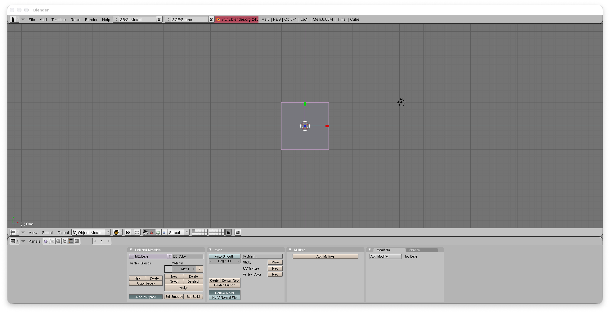

# Blender Classic Retrofit

This project is a simple attempt to build and run Blender 2.45 on Apple Silicon Macs.
It uses native macOS code.
The goal is to keep the Blender 2.45 user experience.

Later work may improve the code under the hood.
These changes must not change how Blender looks or works.

## Status

Alpha release: Blender 2.45 builds as a native arm64 macOS app with its Python 2.5.6 runtime bundled.

The Game Engine and player are disabled. Native GUI launch, foreground rendering, and fullscreen entry/exit have passed local desktop checks. Dependencies are static where supported; SDL and TIFF remain bundled dynamic libraries. This is an ad-hoc signed alpha, without notarization or reference-release parity certification. See [the macOS build receipt](docs/macos-build-preflight.md) for verified coverage and limitations.

## Blender on Apple Silicon

